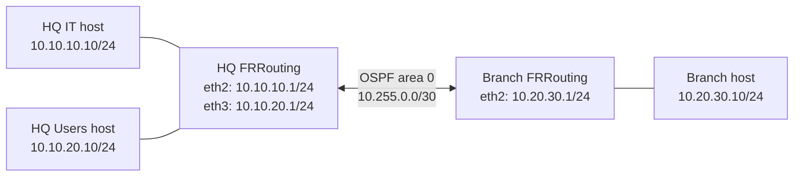

# Enterprise Multi-Site Network Lab — V1 (FRRouting / OSPF / Troubleshooting)

> **Release: V1 source package · Status: Design/configuration complete; live test evidence pending.** This repository provides a reproducible baseline to configure, test, document, and later secure a small enterprise network. Do not mark checks "passed" until you run them locally and capture evidence.

## Included profiles

| Profile | Folder | Capabilities | Implementation status |
|---|---|---|---|
| Base network | repository root | OSPF area 0, HQ/Branch IPv4, reachability, simulated WAN failure | Source prepared; live tests pending |
| Secure extended network | [`secure/`](secure/) | OSPF, tagged VLANs, inter-zone firewall rules, WireGuard tunnel, fail-closed policy, automated checks | Source prepared; live tests pending |

**Publish as a source/design release now; update the documentation and portfolio after local verification.**

## Project summary

A company operates two sites: **Headquarters (HQ)** and **Branch**. HQ has separate IT and end-user subnets. Both sites must exchange routes dynamically using **OSPF area 0**, support end-to-end connectivity, and provide observable behavior during a simulated link failure.

**Technologies:** Containerlab, Docker, FRRouting (FRR), OSPF, Linux iproute2, ping, traceroute, tcpdump/Wireshark.

**Portfolio competencies:** Layer 3 routing, IP addressing, OSPF neighbor formation, multi-subnet reachability, packet capture, network troubleshooting, runbooks, technical documentation, reproducible labs.

## Architecture



**Important:** This **lightweight base profile** uses distinct L3 links, without VLANs or a VPN. The complete **advanced secure profile** in [`secure/`](secure/) includes VLANs, forwarding policies and WireGuard sources; it still needs runtime validation. Neither profile currently includes a Wazuh SIEM or Zabbix.

## IP addressing

| Segment | CIDR | Router/Gateway | Host |
|---|---|---|---|
| HQ↔Branch point-to-point | `10.255.0.0/30` | HQ `10.255.0.1`, Branch `10.255.0.2` | — |
| HQ IT | `10.10.10.0/24` | `10.10.10.1` | `10.10.10.10` |
| HQ Users | `10.10.20.0/24` | `10.10.20.1` | `10.10.20.10` |
| Branch Users | `10.20.30.0/24` | `10.20.30.1` | `10.20.30.10` |

## Requirements

- **Linux machine or Linux VM** with Docker Engine and Containerlab installed.
- **macOS users:** Containerlab networking requires a Linux execution environment. On an Intel Mac with 16 GB RAM, use a lean Ubuntu VM and Docker in the VM. Start with about 4 GB RAM / 2 vCPU allocated to the VM, and increase only if necessary. Do not install heavy Windows Server + Wazuh VMs concurrently on a 16 GB laptop.
- Pull access to `frrouting/frr:latest` and `nicolaka/netshoot:latest` container images.
- Permissions to create container network interfaces; `sudo containerlab` may be required.

**Security:** This is an isolated learning lab. Do not connect an unfiltered lab routing segment to production. Avoid committing passwords, public IPs, customer logs, sensitive network configurations, or private packet captures.

## Deploy (from the Linux environment)

1. Install Docker Engine and Containerlab using their official instructions: https://docs.docker.com/engine/install/ and https://containerlab.dev/install/.
2. Clone this repository and open its directory.
3. Run `sudo containerlab deploy -t topology.clab.yml` (or `sudo bash scripts/start.sh` if Containerlab requires root).
4. Run `bash scripts/verify.sh` (or `sudo bash scripts/verify.sh` if your user cannot access the Docker socket). The script waits up to 60 seconds for OSPF convergence.
5. If tests fail, follow [Troubleshooting](docs/troubleshooting.md) before drawing conclusions.
6. Collect real screenshots/captures following [Evidence checklist](evidence/README.md).
7. Tear down with `sudo containerlab destroy -t topology.clab.yml --cleanup`.

> Image tags are set to `latest` for a starter release. For a portfolio release, **pin tested container image versions/digests** and record them in the environment section of the report.

### Expected successful behavior

- HQ and Branch become OSPF neighbors in the **Full** state.
- HQ learns `10.20.30.0/24` via OSPF; Branch learns `10.10.10.0/24` and `10.10.20.0/24` via OSPF.
- Ping between Branch host and both HQ hosts works **after convergence**.
- Failure of the only WAN link removes learned routes and interrupts branch connectivity; restoration re-establishes adjacency and reachability. **There is no redundant path** in v1, so failover must **not** be claimed.

## Reproducible tests

```bash
# Inspect OSPF neighbor and routing database
docker exec clab-enterprise-network-lab-hq-rtr vtysh -c 'show ip ospf neighbor'
docker exec clab-enterprise-network-lab-hq-rtr vtysh -c 'show ip route ospf'

# Test HQ -> Branch
docker exec clab-enterprise-network-lab-hq-it ping -c 3 10.20.30.10

# Packet capture: OSPF protocol number 89
docker exec clab-enterprise-network-lab-hq-rtr tcpdump -ni eth1 'ip proto 89'

# Failure and recovery demonstration
bash scripts/failure-demo.sh down
bash scripts/failure-demo.sh status
bash scripts/failure-demo.sh up
bash scripts/failure-demo.sh status
```

**Note:** The FRR image may not include `tcpdump` by default. If unavailable, capture using an attached netshoot container, Containerlab capture support, or the Linux VM/host interfaces; see the troubleshooting document. The commands above are an example checklist, not fabricated observations.

## Documentation & proof

| File | Purpose |
|---|---|
| [`topology.clab.yml`](topology.clab.yml) | Reproducible topology |
| [`configs/`](configs/) | FRR addressing and OSPF configs |
| [`scripts/verify.sh`](scripts/verify.sh) | Executable connectivity verification |
| [`scripts/failure-demo.sh`](scripts/failure-demo.sh) | Link failure / recovery demo |
| [`docs/implementation-guide.md`](docs/implementation-guide.md) | Engineering implementation steps |
| [`docs/troubleshooting.md`](docs/troubleshooting.md) | Diagnosis and common issues |
| [`evidence/`](evidence/) | Screenshots and command output you collect locally |

## Roadmap (base profile; corresponding secure features are coded in `secure/`)

- [ ] **Milestone 1 — Verify baseline:** deploy, obtain OSPF Full adjacency, verify routes and bidirectional pings, collect evidence.
- [ ] **Milestone 2 — L2 VLAN segmentation:** add Linux bridges/Open vSwitch and true `802.1Q` tags on a trunk; document VLAN 10 (IT), 20 (Users), 30 (Branch).
- [ ] **Milestone 3 — Security policy:** implement and test explicit traffic filtering with nftables or a firewall VM. Verify **allowed** and **denied** test cases; don't confuse route advertisement filtering with a stateful firewall.
- [ ] **Milestone 4 — Site-to-site VPN:** introduce WAN/ISP node and an IPsec tunnel with strongSwan or properly licensed FortiGate/Palo Alto lab images. Validate IKE/IPsec SAs and protected subnets.
- [ ] **Milestone 5 — Observability:** add SNMP/Zabbix, Syslog or Wazuh agents and at least one reproducible detection/incident report.
- [ ] **Milestone 6 — Redundancy:** add a second WAN path and demonstrate measured OSPF convergence after link failure.

## Current portfolio summary

> Prepared a reproducible two-site network lab with FRRouting/OSPF, VLAN segmentation, firewall policies and a WireGuard overlay. Published topology, configurations, acceptance scripts and troubleshooting documentation. Runtime OSPF, VPN and firewall validation is pending; no successful deployment is claimed.

## Extended secure profile

For the complete two-site implementation, including Linux switch VLAN tagging, FRR OSPF, WireGuard encryption, iptables segmentation and security acceptance checks, see **[`secure/README.md`](secure/README.md)**. A green static CI result does not mean network connectivity was proven.

## Limitations

The base scenario is **not** a production-grade design and is not currently a VPN, firewall, SIEM or VLAN demo. It has no internet gateway, DHCP, AD or high availability. It is purposely lightweight and modular so each subsequent security/infrastructure feature can be honestly implemented, tested and documented.

## License

MIT, for repository documentation/scripts/config examples. Respect upstream FRR, Containerlab, image and network OS license terms.

## Publishing V1 responsibly

- This commit is a **configuration/design release**, not proof of a successful deployment.
- The GitHub project page and CV should say **"V1 — lab configured; validation in progress"**.
- When real test evidence exists, update the `evidence/` folder and release notes.
- The complete publication checklist is in [`docs/PUBLISHING.md`](docs/PUBLISHING.md).
