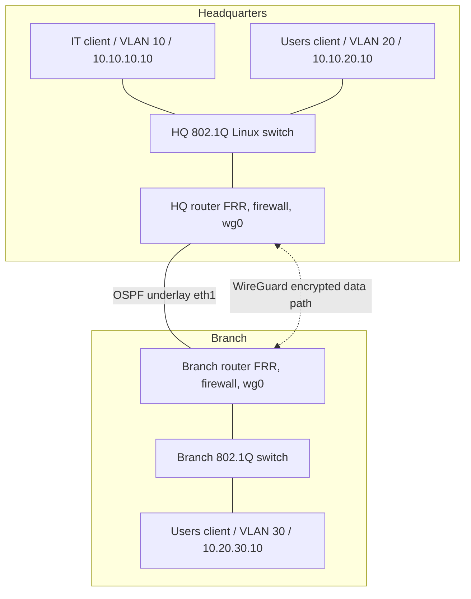

# Technical implementation dossier — Enterprise Multi-Site Network Lab V1

**Prepared by:** Taha Zitane | Personal network engineering portfolio | October 2026

**Document state:** Detailed implementation plan and configuration source are prepared. No router/VPN operational success is asserted before deployment and evidence review.

## 1. Business use case

A hypothetical organization operates a headquarters (HQ) with separate IT and end-user departments and a remote Branch office. HQ IT needs to reach the Branch for administrative connectivity. Branch staff need access to HQ's general user VLAN but must not access IT systems. Inter-site user traffic should be encrypted and must not silently fall back to the unencrypted WAN when the VPN is unavailable.

### Design objectives

1. Reproducible, low-cost virtual topology runnable on an Ubuntu Linux VM.
2. OSPF dynamic route propagation across a controlled WAN underlay.
3. Explicit separation of HQ IT and HQ general-user traffic with 802.1Q VLANs.
4. Encrypted point-to-point routed VPN with locally generated keys.
5. Transparent access policies, including negative access tests.
6. Measurable validation and evidence collection without fabricated results.

## 2. Scope and assumptions

- The complete profile lives in [`secure/`](../secure/).
- This is intentionally a *single-WAN, IPv4-only, isolated* lab. No redundancy or measured SLA.
- Containerlab creates Linux-based node containers and interconnects their interfaces.
- Ubuntu-router containers run FRRouting; switch containers use Linux bridges in VLAN-aware mode.
- WireGuard runs on the Linux kernel of the host VM; kernel support is required.
- Management network interfaces created by Docker/Containerlab are out-of-band and **not** a model of production network management isolation.
- Firewall example policies use iptables for IPv4; no IPv6 routing or policy is defined.

## 3. IP and VLAN plan

| Link/role | Prefix | HQ router | Branch router | Notes |
|---|---|---|---|---|
| WAN | 172.16.255.0/30 | 172.16.255.1 | 172.16.255.2 | OSPF control plane |
| WireGuard | 10.254.0.0/30 | 10.254.0.1 | 10.254.0.2 | VPN overlay |
| HQ IT VLAN 10 | 10.10.10.0/24 | 10.10.10.1 | - | Test host 10.10.10.10 |
| HQ Users VLAN 20 | 10.10.20.0/24 | 10.10.20.1 | - | Test host 10.10.20.10 |
| Branch Users VLAN 30 | 10.20.30.0/24 | - | 10.20.30.1 | Test host 10.20.30.10 |

## 4. Topology and traffic path



In the simulation, underlay OSPF exchanges routes on `eth1`. Inter-site traffic uses more preferred kernel routes through `wg0`. Forwarding rules deny corporate inter-site packets leaving via unencrypted `eth1`. No IPsec or device-specific Fortinet/Palo Alto appliance is claimed here.

## 5. Deployment procedure (not yet performed)

Host preparation:

```bash
# Ubuntu Linux VM (use current vendor documentation for installation steps)
sudo apt update
sudo apt install -y git curl ca-certificates
# Install supported Docker Engine + Containerlab CLI per official docs:
# https://docs.docker.com/engine/install/
# https://containerlab.dev/install/
# Verify host kernel can create a WireGuard interface.
```

Deploy (from repository root):

```bash
cd secure
sudo bash scripts/deploy.sh
sudo bash scripts/verify.sh
sudo bash scripts/failclosed.sh
sudo bash scripts/observe.sh
```

Teardown:

```bash
sudo bash scripts/destroy.sh
```

`deploy.sh` builds a local Ubuntu FRR router image, starts the Containerlab topology, configures VLAN-aware bridges and router subinterfaces, starts FRR and firewall policies, and configures WireGuard. The project must be debugged against the user VM before its runtime status can be upgraded.

## 6. Automated acceptance matrix

| Test | Command/script | Pass condition | Status today |
|---|---|---|---|
| Static source syntax | `python -m unittest discover -s tests -v` | YAML, Bash, required files parse | PASSED in authoring container |
| OSPF adjacency | `secure/scripts/verify.sh` | Full on both routers | NOT RUN on VM |
| OSPF advertisement | Same | Correct learned prefixes | NOT RUN on VM |
| 802.1Q port membership | Same | VLANs 10/20/30 assigned | NOT RUN on VM |
| VPN route preference | Same | Inter-site route uses wg0 | NOT RUN on VM |
| Allowed connectivity | Same | HQ IT ↔ Branch / Branch ↔ HQ Users | NOT RUN on VM |
| Forbidden connectivity | Same | HQ Users → HQ IT and Branch → HQ IT blocked | NOT RUN on VM |
| Key exchange | Same | WireGuard latest handshake recorded | NOT RUN on VM |
| VPN fail closed | `secure/scripts/failclosed.sh` | WAN cannot transmit corporate cleartext | NOT RUN on VM |
| Evidence capture | `secure/scripts/observe.sh` | Timestamped real route/policy/test logs | NOT RUN on VM |

## 7. Threat and risk notes

- **Accidental plaintext routing:** VPN teardown might reveal underlay routes. The egress deny on `eth1` exists to fail closed.
- **Unauthorized IT access:** separate VLANs do not by themselves enforce policy. The HQ FORWARD chain prevents specified traffic classes.
- **Key exposure:** runtime private keys live under gitignored `secure/.secrets/` and in container `/run/`. Never commit this directory; rotate after disclosure.
- **OSPF spoofing:** unauthenticated control-plane traffic is a limitation of this demonstration. Production networks must use appropriate route authentication and control-plane separation.
- **Image supply chain:** Containerlab/Netshoot image tags are unpinned for early authoring. After a successful run, pin versions or digests and review updates.
- **Test quality:** Negative tests can falsely succeed if routing is broken; run positive reachability assertions before deny checks.

## 8. Evidence checklist for recruiters

After a successful real run:

- Screenshot 1: Containerlab topology with all nodes running.
- Screenshot 2: `show ip ospf neighbor` (FULL adjacency).
- Screenshot 3: `show ip route ospf` on both routers.
- Screenshot 4: `bridge vlan show`, demonstrating trunk/access membership.
- Screenshot 5: WireGuard `wg show` handshake (without sensitive keys).
- Screenshot 6: Successful allowed pings and unsuccessful denied pings.
- Screenshot 7: Fail-closed test during wg0 outage.
- Technical incident report: one real fault and how it was resolved.

Screenshots are intentionally **not** included yet.

## 9. What to say in an interview

**Q: Why FRRouting?** A: Open-source routing suite on Linux that allows a reproducible, code-reviewed OSPF exercise without licensed routers.

**Q: Why use VLANs?** A: To split layer-2 broadcast domains; a VLAN alone is not a security boundary when routed communication remains available.

**Q: Does OSPF protect LAN traffic?** A: No, OSPF advertises routes. The data-plane VPN and firewall policies control inter-site encryption and access.

**Q: Why not claim 99.9% uptime?** A: This profile has no redundant WAN, measured availability or performance baseline.

**Q: Have you tested it?** A: At this stage I published configurations and automated acceptance scripts. I will label the lab validated only after running and documenting the real results on my Linux VM.

## 10. Development roadmap

- **V1:** Completed source package for both base and secure lab profiles, static CI, verification scripts and portfolio/CV description. Live validation pending.
- **V1.1:** Resolve VM-specific issues, pin images, attach redacted evidence, change the status to lab validated.
- **V2:** Add DNS/DHCP and Linux observability metrics; compare technical support cases.
- **V3:** Add a separate FortiGate/Palo Alto licensed demonstration and a Wazuh monitoring/incident module, then run security test cases.
- **V4:** Redundant WAN links with quantified convergence times and fault-tolerance report.
