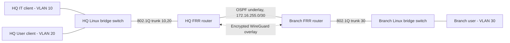

# Secure Enterprise Network Lab — full implementation sources (V1, not runtime validated)

> **State:** Complete lab source package prepared. Live execution / successful acceptance tests **not yet confirmed**. This is a *sandbox demonstration*, not production engineering.

## Scope

- Two geographically separated simulated sites: HQ and Branch.
- Two HQ security VLANs (802.1Q VLAN 10 for IT; VLAN 20 for Users), one Branch user VLAN (30).
- Layer 3 gateways on Ubuntu FRR routers; separate Linux-bridge access switches and 802.1Q trunks.
- OSPF dynamic route advertisement across a point-to-point WAN underlay (`172.16.255.0/30`).
- WireGuard encrypted overlay (`10.254.0.0/30`) with generated ephemeral keys (stored only locally).
- Preferred cross-site *data* routes through `wg0`; explicit egress filters prevent cleartext WAN fallback.
- IP forwarding access policy: HQ Users and Branch Users cannot initiate access to HQ IT subnet.
- Automated verification, fail-closed test and timestamps/evidence collection.

**Not included:** FortiGate/Palo Alto images, high-availability, DHCP, Active Directory, Zabbix, a Wazuh SIEM, production PKI. Do not claim those are running as part of this secure profile. These are separate lab projects or follow-up modules.

## Visual architecture



## Network inventory

| Zone | Network | Gateway | Host | VLAN |
|---|---|---|---|---|
| HQ IT | 10.10.10.0/24 | 10.10.10.1 | 10.10.10.10 | 10 |
| HQ Users | 10.10.20.0/24 | 10.10.20.1 | 10.10.20.10 | 20 |
| Branch Users | 10.20.30.0/24 | 10.20.30.1 | 10.20.30.10 | 30 |
| WAN underlay | 172.16.255.0/30 | HQ .1, Branch .2 | - | - |
| Encrypted VPN | 10.254.0.0/30 | HQ .1, Branch .2 | - | - |

## Prerequisites

- **Linux VM** (e.g. Ubuntu on an Intel Mac) with Docker Engine, Docker Compose optional, Containerlab CLI.
- Linux kernel with WireGuard support. If `ip link add wg0 type wireguard` fails, install/enable appropriate WireGuard support on the VM host.
- 4–6 GB RAM for the Linux VM initially, more only if required. Run **only one profile** (base or secure) at a time to conserve memory.
- Internet connectivity for package and container image downloads.

## Deploy

```bash
cd secure
sudo bash scripts/deploy.sh
sudo bash scripts/verify.sh
sudo bash scripts/failclosed.sh
sudo bash scripts/observe.sh
sudo bash scripts/destroy.sh
```

`deploy.sh` builds an Ubuntu 24.04 router image with FRR and WireGuard tooling, deploys six networking containers plus the Branch client (seven nodes total), runs VLAN/ACL/OSPF initialization and provisions WireGuard credentials. **This execution has not been performed in this authoring environment.** Ubuntu/Docker/Containerlab or FRR differences may require fixes on the target machine. If a step fails, see `docs/TROUBLESHOOTING.md`, keep failure logs, and update the repository honestly.

## Explicit security policy

| Source → Destination | Expected | Technical control |
|---|---|---|
| HQ IT → Branch Users | ALLOW | IP forwarding via encrypted WG |
| HQ Users → Branch Users | ALLOW | IP forwarding via encrypted WG |
| Branch Users → HQ Users | ALLOW | IP forwarding via encrypted WG |
| HQ Users → HQ IT | DENY | HQ router iptables FORWARD |
| Branch Users → HQ IT | DENY | HQ router iptables FORWARD |
| Any inter-site corporate traffic with WG down | DENY | egress deny on WAN `eth1` |

Return traffic for allowed sessions is accepted via `ESTABLISHED,RELATED` conntrack rule. Underlay routing metadata uses plain OSPF on isolated WAN: this is **not** appropriate as a production design without further authentication or isolation.

## Evidence and quality

- `bash scripts/verify.sh` prints actual pass/fail for OSPF, VLANs, routing, allowed and denied traffic, VPN handshake.
- `bash scripts/failclosed.sh` tests tunnel outage without silent fail-open routing.
- `bash scripts/observe.sh` records **actual** routing, policies and verification outputs to gitignored paths; you decide which redacted evidence to publish.
- GitHub CI in the repo performs **static** integrity checks only; a green badge must not be interpreted as working packet delivery.

## Safe publishing statement

> Designed and version-controlled a reproducible two-site network laboratory with FRRouting/OSPF, 802.1Q VLAN separation, policy-based traffic restrictions and a WireGuard site-to-site overlay. Configuration and acceptance-test scripts are provided; execution evidence is pending.

## After verification

Once screenshots and logs exist, change the status to **tested** and add them under `secure/evidence/` in anonymized form. Optionally add Zabbix/Wazuh and a dual-WAN topology in a later version.
